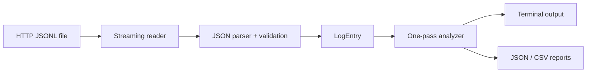

# LogPilot

**Streaming HTTP log analytics, right in your terminal.**

[](https://github.com/Mhmdhalim/logpilot/actions/workflows/ci.yml)


LogPilot is a lightweight **Python CLI tool** for analyzing structured HTTP request logs. It reads JSONL files **one line at a time**, validates each record, and turns raw requests into useful statistics and reports — without loading the entire log file into memory.

Built with **Python, generators, dataclasses, argparse, pytest, and GitHub Actions**.

## See it in action

Clone the repository, install it, and run:

```console
logpilot analyze examples/server.jsonl
```

**Actual output from the included sample file:**

```text
LogPilot — HTTP log summary
Total requests:       4
Error requests:       2
Error rate:           50.00%
Average latency:      100.00 ms
Maximum latency:      300.00 ms
Unique endpoints:     2
Status categories:    1xx: 0  2xx: 2  3xx: 0  4xx: 1  5xx: 1
```

Find your busiest endpoints:

```console
logpilot top examples/server.jsonl --limit 5
```

```text
Requests  Endpoint
       3  /api/users
       1  /api/login
```

[View a successful CLI run in GitHub Actions](https://github.com/Mhmdhalim/logpilot/actions/runs/45290860482/job/138098939781).

## Features

- **Streaming log reader:** processes UTF-8 JSONL records lazily with Python generators.
- **Strict validation:** checks timestamps, HTTP methods, paths, status codes, and latency values.
- **HTTP analytics:** total requests; 1xx–5xx status distribution; status-code counts; 4xx/5xx error counts and rates.
- **Performance metrics:** average and maximum response latency in milliseconds.
- **Endpoint ranking:** count requests by URL path with deterministic ordering for ties.
- **Error inspection:** print 4xx/5xx requests, optionally filtered by an exact status code.
- **Exports:** save complete analysis as JSON or CSV.
- **Automated quality checks:** pytest, Ruff, and GitHub Actions on Python 3.11, 3.12, and 3.13.

## Quick start

### 1. Clone

```bash
git clone https://github.com/Mhmdhalim/logpilot.git
cd logpilot
```

### 2. Install (Python 3.11+)

**Windows — PowerShell**

```powershell
python -m venv .venv
.\.venv\Scripts\Activate.ps1
python -m pip install -e .
```

**macOS / Linux**

```bash
python3 -m venv .venv
source .venv/bin/activate
python -m pip install -e .
```

The installation exposes the `logpilot` command. If your PowerShell execution policy blocks virtual-environment activation, you can use `.\.venv\Scripts\python.exe -m pip install -e .` and then `.\.venv\Scripts\python.exe -m logpilot analyze examples/server.jsonl` instead.

### 3. Try the commands

```bash
logpilot analyze examples/server.jsonl
logpilot analyze examples/server.jsonl --json
logpilot errors examples/server.jsonl --status 500 --limit 10
logpilot top examples/server.jsonl --limit 5
logpilot report examples/server.jsonl --output report.json
logpilot report examples/server.jsonl --output report.csv
```

You can also run it as a Python module: `python -m logpilot analyze examples/server.jsonl`.

## CLI reference

| Command | Description |
| --- | --- |
| `logpilot analyze FILE` | Print a human-readable analytics summary |
| `logpilot analyze FILE --json` | Print the complete result as JSON |
| `logpilot errors FILE [--status CODE] [--limit N]` | Display up to N matching HTTP 4xx/5xx requests (default 20) |
| `logpilot top FILE [--limit N]` | Show the N most requested paths (default 5) |
| `logpilot report FILE --output OUTPUT [--format json\|csv]` | Write a JSON or CSV report; format defaults to the file extension |
| `logpilot --help` | Display CLI help |
| `logpilot --version` | Display the installed version |

`--limit` must be a positive integer. `--status` accepts only 400–599. Errors are printed to stderr and cause a nonzero exit code. Report outputs overwrite existing destination files.

## Example: exported report

```bash
logpilot report examples/server.jsonl --output report.json
```

The resulting JSON file contains:

```json
{
  "summary": {
    "total_requests": 4,
    "error_requests": 2,
    "error_rate_percent": 50.0,
    "average_latency_ms": 100.0,
    "maximum_latency_ms": 300.0,
    "unique_endpoints": 2
  },
  "status_categories": {
    "1xx": 0,
    "2xx": 2,
    "3xx": 0,
    "4xx": 1,
    "5xx": 1
  },
  "status_codes": {
    "200": 2,
    "404": 1,
    "500": 1
  },
  "endpoints": [
    {"path": "/api/users", "requests": 3},
    {"path": "/api/login", "requests": 1}
  ]
}
```

CSV export uses the columns `section,name,value` so the result is easy to inspect in spreadsheet software.

## Input format

LogPilot accepts **newline-delimited JSON (JSONL)**: one JSON object per nonblank line. Example:

```json
{"timestamp":"2026-11-18T10:00:00Z","method":"GET","path":"/api/users","status":200,"duration_ms":20}
```

| Field | Requirement |
| --- | --- |
| `timestamp` | ISO 8601 timestamp with timezone information, e.g. `2026-11-18T10:00:00Z` |
| `method` | Nonempty string, e.g. `GET` or `POST` |
| `path` | String starting with `/` |
| `status` | Integer HTTP status from 100 to 599 |
| `duration_ms` | Finite, nonnegative number representing milliseconds |

Blank lines are skipped. If a line contains invalid JSON or invalid field values, processing **stops with a descriptive error including the file and physical line number**; bad records are not silently ignored.

> **Note:** This version expects structured JSONL. It does **not** parse plain-text Apache or Nginx access logs directly.

## How it works



| File | Responsibility |
| --- | --- |
| `src/logpilot/models.py` | Immutable `LogEntry` dataclass |
| `src/logpilot/parser.py` | JSON decoding, validation, timestamp normalization |
| `src/logpilot/reader.py` | Lazy file iteration, blank-line skipping, file/line error context |
| `src/logpilot/analyzer.py` | Request counts, error rates, latencies, endpoint aggregation |
| `src/logpilot/reporter.py` | Terminal summary formatting and JSON/CSV export |
| `src/logpilot/cli.py` | Command-line arguments, dispatch, error messages, exit codes |
| `src/logpilot/__main__.py` | Entry point for `python -m logpilot` |

See [Architecture & Complexity](docs/architecture.md) for a deeper explanation.

### Streaming and complexity

The analyzer makes **one pass** over its input, tracking aggregate counters instead of retaining every `LogEntry`. For **N** records, **U** unique paths, and **S** distinct status codes:

- Expected aggregation time: **O(N)**.
- Additional analyzer memory: **O(U + S)**.
- Ranking endpoints: **O(U log U)** time and **O(U)** memory.

The reader additionally holds the current log line in memory. Distinct endpoint counts can still increase memory use; “streaming” does not mean constant total memory for every possible input.

## Development and tests

Install development dependencies:

```bash
python -m pip install -e ".[dev]"
```

Run tests and linting:

```bash
python -m pytest -v
python -m ruff check .
```

The test suite covers parser validation, file reading, generators, analytics, CLI behavior, error handling, and report exports. GitHub Actions runs these checks across Python 3.11–3.13.

Run the optional benchmark:

```bash
python benchmarks/benchmark_reader.py --rows 100000
```

The benchmark reports elapsed time and Python allocation peak using `tracemalloc`. Results depend on your machine and should not be interpreted as production performance guarantees.

## Limitations

- Designed for structured HTTP JSONL logs, not unstructured server access-log formats.
- Calculates average and maximum latency, **not exact p95/p99 percentiles**.
- Fails fast on malformed entries rather than skipping or recovering from them.
- Supports local CLI analysis; this is **not a hosted dashboard or monitoring service**.

## License

Distributed under the [MIT License](LICENSE).
